<p align="center">
  
</p>

<p align="center">
  
</p>

<p align="center">
    
</p>

<p align="center">
  <a href="https://www.linkedin.com/in/YOUR-LINKEDIN-USERNAME">
    
  </a>
  <a href="mailto:YOUR-EMAIL@example.com">
    
  </a>
  
</p>


## 👨‍💻 About Me

```text
$ whoami
sai-jagadeesh · 2nd-year B.Tech · AI & Data Science

$ cat interests.txt
AI · Generative AI · Software Development · DSA · Computer Systems

$ cat status.txt
Open to internships and hackathons
```

- 📱 Building an app development project with **FlutterFlow**
- 🧠 Practising **Data Structures & Algorithms** in C, C++ and Python
- 🌱 Currently learning **Firebase, Supabase, Java, React, Node.js and SQL**
- 🎯 Goal: keep building more technical skills


## 🛠️ Skills & Technologies

<h3 align="center">💻 Programming Languages</h3>
<p align="center">
  
</p>

<h3 align="center">🌐 Web Development</h3>
<p align="center">
  
</p>

<h3 align="center">📱 App Development</h3>
<p align="center">
  
</p>

<h3 align="center">📊 Data Science</h3>
<p align="center">
  
</p>

<h3 align="center">🧰 Tools & Platforms</h3>
<p align="center">
  
</p>

<h3 align="center">🧩 Problem Solving</h3>
<p align="center">
  
</p>


## 🌱 Currently Learning

<p align="center">
  
  <br />
  
</p>


## 🚀 Featured Project

| Project | Description | Status |
|---|---|---|
| 📱 **Mobile App Project** | A mobile app built with FlutterFlow. Details will be added as the project progresses. | 🛠️ In development |


## 📈 GitHub Stats

<p align="center">
  
  
</p>

<p align="center">
  
</p>

<p align="center">
  
</p>


## 🐍 Contribution Snake

<p align="center">
  
</p>

<p align="center">
  <i>Learning something new every day. Let's build together. 🚀</i>
</p>

<p align="center">
  
</p>